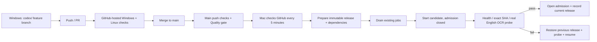

# Windows development → GitHub Actions → Mac production

Windows is the development machine. `main` is the deployment branch. A feature branch or PR runs checks without changing the Mac. A successful **push run for the exact current main SHA** makes that release eligible for automatic deployment.



## Quality gate

`.github/workflows/ci.yml` runs on GitHub-hosted `windows-latest` and `ubuntu-latest`, using Python 3.12, frozen reader dependencies and SHA-pinned checkout/setup-uv actions. It compiles shipped Python and runs routing, PDF range, caching, upload/job persistence, OCR completion, maintenance/admission and rollout/rollback tests. `Quality gate` requires both platform jobs to pass.

The gate covers program behavior and a small post-deploy English OCR sanity test. It does not certify historical Thai OCR/table accuracy; known benchmark limitations remain. Model benchmarks are a separate reviewed activity, not a hidden paid Firecrawl step on every push.

## Mac deployment controller

The Mac polls outward, so no production port or SSH key is exposed through Actions. GitHub-hosted jobs never run directly on the production Mac. Public-repository workflow results can be read without a GitHub token. The controller accepts only `main`, event `push`, the exact SHA, the configured repository/workflow, the newest successful run and all three expected successful job names. PR/fork runs and older successes cannot authorise deployment.

Files under `~/research-server/deployments/`:

- `config.json`: fixed repository/main policy.
- `bin/deploy_agent.py`: installed controller, independent of changing release paths.
- `source.git`, `releases/<sha>/`: Git mirror and clean detached release checkouts.
- `ocr-environments.json`, `environments/ocr-<lock-hash>/`: reuse the verified baseline OCR environment or prepare a new environment for a changed lock; do not upgrade the rollback environment in place.
- `state.json`: current, previous and failed release records.
- `status.json`, `events.jsonl`, `last-probe.json`: actual deployment state and probe result. `/health` includes the short deployment status.

The controller is a user LaunchAgent named `local.crawl-search.deploy`, run at login and every 300 seconds. It uses an OS lock so two deploys cannot overlap. Logs are `~/research-server/logs/deploy.log` and `deploy.err.log`. It runs alongside the four existing service supervisors. Mac login is still required after reboot.

Source preparation and dependency installation happen before pausing production. The controller then closes admission and lets accepted jobs finish, for up to fifteen minutes. A candidate starts closed to normal submissions; only the internal probe can submit while it is checked. The admitted SHA in durable state lets an ordinary later process restart reopen the accepted release, rather than leaving the service stuck in maintenance.

The probe checks live SearXNG/worker/OCR service health, the exact deployed SHA and an uncached uploaded English image with three expected anchors. It does not depend on an upstream search query escaping CAPTCHA. On failure, the previous code/environment is restored and checked. The failed SHA is held rather than retried endlessly; a new main commit can attempt the next deployment. State/uploads/cache remain shared; this rollout does **not** introduce a database schema migration.

## Bootstrap / controller updates

Run on the Mac from the checked-out code after the existing service is healthy:

```sh
research-tools/local-research/.venv/bin/python deploy/mac/install_deployer.py
```

The first installation records the actually running commit, verifies the installed OCR versions against its lock and prepares that immutable rollback release. It registers the controller without replacing the running service. It then waits for main to pass its push gate.

Controller code is deliberately copied outside release directories. Changes to the controller/policy itself require running this installer again from reviewed code. Service code and locked environment updates deploy automatically. Model weight revisions must be present on the Mac before a service change that requires them; a missing/invalid model causes probe failure and rollback.

## Daily use

1. Develop and test on Windows in a `codex/` branch, then push.
2. Inspect the GitHub Actions checks and merge the PR into `main` when ready.
3. The main push is checked again. Within the next five-minute poll, Mac prepares and deploys that exact successful main commit.
4. Inspect `/health` through `research_health`, or the controller's status/logs, to confirm actual deployment. A green CI badge is eligibility, not proof that an offline Mac has deployed.

To stop automatic deployment while leaving research services running:

```sh
launchctl bootout "gui/$(id -u)/local.crawl-search.deploy"
```

To check immediately using the same policy (without bypassing gates):

```sh
~/research-server/envs/ocr/bin/python ~/research-server/deployments/bin/deploy_agent.py --config ~/research-server/deployments/config.json
```

After fixing an external issue, `--retry` permits another attempt at a previously failed SHA. Normal code rollback can also be a revert commit on main, which goes through the same checks. Release directories and environments are retained; retention/pruning is not automatic yet. Model/cache/DB format changes must preserve compatibility with the previous release for automatic rollback to remain valid.

Branch protection is not required for the Mac's gate: an unverified/broken main push is not deployed. Repository owners may additionally require `Quality gate` before merging; this setup does not claim to have configured an admin branch-protection rule.

Official references: [workflow triggers](https://docs.github.com/en/actions/how-tos/write-workflows/choose-when-workflows-run/trigger-a-workflow), [public workflow run API](https://docs.github.com/en/rest/actions/workflow-runs), [self-hosted runner trust boundary](https://docs.github.com/en/actions/reference/security/secure-use#hardening-for-self-hosted-runners).
