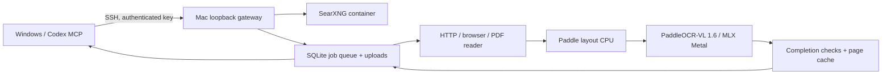

# Mac research server

Activated on 2026-11-01 on a Mac mini M4, 16 GiB unified memory, macOS 26.3. Windows now runs the thin MCP bridge. Its previous `searxng-local` and `local-research-ocr` containers are stopped with restart policy `no`.

## Data flow



Jobs, uploads and results live on the Mac. A job continues after client disconnect. A single queue consumer limits heavy work; OCR also serialises recognition. A crash requeues running jobs up to three attempts. Recovery restarts the job and can reuse valid page cache; there is no live page-progress API yet.

## Active services

All ports bind to `127.0.0.1`, reached by SSH rather than public/LAN HTTP exposure.

| Component | Port | Runtime / supervision |
|---|---:|---|
| Gateway and durable jobs | 8768 | Reader Python 3.12 / `local.crawl-search.api` |
| SearXNG | 8088 | ARM64 Docker / `local.crawl-search.search` watchdog |
| Native document OCR | 8091 | Separate OCR Python / `local.crawl-search.ocr` |
| Recognition proxy | 8112 | Part of native OCR service |
| MLX recognition | 8111 | Metal / `local.crawl-search.mlx` |

LaunchAgents run for the logged-in Mac user, with restart supervision and `caffeinate -i` to prevent idle system sleep. The search watchdog starts Docker Desktop in the background when needed and ensures the container runs. Login after reboot is required; this is not a pre-login daemon. Full reboot/login recovery has not yet been tested.

Search engines: Brave, DuckDuckGo, Yahoo, Mwmbl and Wikipedia. Google/Bing/Qwant were denied or failed during deployment. CAPTCHA remains possible: responses retain `engine_errors`, and empty results request native search rather than claiming success. Public search availability is not guaranteed.

## Installed OCR backend

- PaddleOCR 3.7.0, PaddlePaddle 3.2.1, MLX-VLM 0.7.11, MLX/MLX-Metal 0.32.4.
- Model: `PaddlePaddle/PaddleOCR-VL-1.6`, revision `c5630abae1d940eafe0697512a0325494b02ab42`.
- PP-DocLayoutV3 detects regions on CPU; the full Paddle pipeline assembles MLX recognition results. The MLX endpoint alone is not the document pipeline.
- Actual dependency versions: [`ocr-requirements.lock.txt`](../deploy/mac/ocr-requirements.lock.txt). This is a version capture, not a wheel-hash lock. Layout weights downloaded by Paddle are not separately revision-pinned yet.
- `balanced` and `quality` currently use the same backend. `language_hint` is metadata, not a model selector. RapidOCR/Typhoon/LightOnOCR are not active Mac fallback routes.
- Missing/non-normal finish reasons, long repetition, very short text and unclosed HTML tables fail completion checks. Failed output is not cached as successful. These checks cannot prove spelling, number or table accuracy.
- Limits: the proxy caps regions at 8,192 tokens, but benchmark logs show requests stopping at 4,096; the cap does not enlarge a smaller upstream request budget. Other limits: 20 MiB/16 megapixels per image; 32 MiB per upload/download; ten PDF pages per requested range. A read tool waits up to ten minutes, then returns a persistent job ID if pending.

Uploaded documents have no public URL, so failed reads request local review. Public URL failures can request the connected client's Firecrawl tool; credentials remain on the client, and the server does not call paid APIs automatically.

## Recreate the environments

Prerequisites: Apple Silicon Mac, Homebrew `uv`, Git, Docker Desktop installed/running, sufficient disk space. The system Python 3.9 is not used. Clone into `~/research-server/crawl-search` and select the intended branch or reviewed commit.

```sh
cd ~/research-server/crawl-search/research-tools/local-research
uv sync --frozen --python 3.12 --extra browser
.venv/bin/python -m playwright install chromium
.venv/bin/python -m patchright install chromium
cd ../..
uv venv --python 3.12 ~/research-server/envs/ocr
uv pip sync --python ~/research-server/envs/ocr/bin/python deploy/mac/ocr-requirements.lock.txt
```

Download the pinned recognition model and install services:

```sh
HF_HUB_DISABLE_XET=1 ~/research-server/envs/ocr/bin/python -c "from huggingface_hub import snapshot_download; print(snapshot_download('PaddlePaddle/PaddleOCR-VL-1.6', revision='c5630abae1d940eafe0697512a0325494b02ab42'))"
research-tools/local-research/.venv/bin/python deploy/mac/install_services.py
```

The installer updates managed engines while preserving the SearXNG secret, pins the Docker image by digest, sets resource bounds and installs four user LaunchAgents. It refuses to silently replace a container with different image content. First OCR use may download layout weights and initialise the pipeline.

## Windows client

Register `research-tools/local-research/client.py` using a Python environment with this package's MCP/httpx dependencies. Set these variables in the MCP entry:

- `RESEARCH_SSH_HOST`: `username@mac-address`.
- `RESEARCH_SSH_KEY`: absolute private-key path.
- `RESEARCH_SSH_KNOWN_HOSTS`: absolute verified-host-key path.
- `PYTHONIOENCODING`: `utf-8`.

The bridge creates a random local SSH port, enforces host-key verification and closes its tunnel on exit. Readers run on Mac; `research_read_file` uploads the selected client file with SHA-256 deduplication. Keep keys and plugin credentials out of Git.

Run `configure_mcp.py` after registration to set only this entry's startup timeout to 30 seconds and tool timeout to 660 seconds. Reload the MCP connection/client session to load the changed tool catalog.

Tools: `research_health`, `research_search`, `research_submit`, `research_job`, `research_read`, `research_read_file`, `research_read_many`, `research_complete_fallback`. Use submit/job for long work. After reconnecting, retrieve the same job ID.

## Operations

Repository: `~/research-server/crawl-search`. Private state: `~/research-server/state`. Logs: `~/research-server/logs/{api,ocr,mlx,search}.{log,err.log}`. Generated settings: `~/research-server/config/searxng/settings.yml`.

Deploy from a clean checkout, then refresh processes and the reported commit:

```sh
git pull --ff-only origin codex/research-server-bootstrap
research-tools/local-research/.venv/bin/python deploy/mac/install_services.py
```

Restart one service, preserving completed job data:

```sh
launchctl kickstart -k "gui/$(id -u)/local.crawl-search.api"
```

Stop all four supervisors before stopping the search container. Files remain for restart:

```sh
for name in api ocr mlx search; do
  launchctl bootout "gui/$(id -u)/local.crawl-search.$name"
done
/usr/local/bin/docker stop crawl-search-searxng
```

There is no automatic state retention policy yet. Back up or prune completed jobs/uploads deliberately. Keep the migration snapshot and Windows prototype until the new real-document benchmark is reviewed.

## Verification on 2026-11-01

- 21 automated checks passed on Windows and Mac: routing, PDF ranges, mixed PDFs, failed-result caching, job persistence, uploads and completion gates.
- Actual Windows MCP → SSH → Mac calls passed: search 0.91 s, HTTP article 1.09 s, rendered JavaScript 6.50 s, uncached Thai image OCR 8.59 s. Single smoke runs, not throughput/p95 benchmarks. The recognition model was warm; the layout service had restarted before this run.
- English image OCR completed after client disconnect/reconnect. First initialisation took about 71 s including cold setup; recognition was about 5 s.
- The completed Thai result remained unchanged after restarting the gateway.
- A two-page PDF completed in 0.59 s with matching SHA-256, both page markers present, and no OCR. Its result remained available after closing/reopening the MCP session. Duplicate URLs shared one job.
- A real Census 1900 dense table page failed the normal-finish check after 49.4 s and returned `needs_review=true`, zero credits, and no automatic external upload. Dense historical tables are still an unresolved OCR limitation.
- Thai output included an extraneous Chinese fragment despite normal finish reasons. Successful completion does not imply accurate OCR. A fresh same-corpus comparison is now available in [the Mac benchmark](../research-benchmarks/mac-vs-firecrawl-2026-11-01/REPORT.md): seven of sixteen Mac requests were rejected, with backend length stops at 4,096 tokens. The native pipeline is not an accurate replacement for every scanned document.

Run `deploy/mac/smoke.py` on Mac for the API check. Run `deploy/mac/client_smoke.py` on Windows with SSH variables and `CLIENT_SMOKE_OUTPUT` set. `deploy/mac/document_smoke.py` checks two-page transfer hashes, deduplication and reconnects; set `DOCUMENT_SMOKE_OUTPUT` and optionally `RESEARCH_SMOKE_TABLE` to a scanned table image.

Official reference: [PaddleOCR Apple Silicon deployment](https://www.paddleocr.ai/latest/en/version3.x/pipeline_usage/PaddleOCR-VL-Apple-Silicon.html).

## Experimental OCR output controls (PR #3; not deployed to main)

The follow-up candidate serializes recognition requests into MLX and forwards an explicit 8,192-token recognition budget and `repetition_penalty=1.0` with a 64-token context to MLX. `MAC_OCR_REPETITION_PENALTY` accepts 1.0–1.2; changing it invalidates page results. Normal-finish, repeated-output and table-closure checks remain required. These settings require measured accuracy review; they are not proof of complete or correct recognition.

Table markup is compacted by removing presentation attributes while preserving cells, text, row/column spans and element structure. Per-page results retain region provenance and the original markup length.

For the candidate API/MCP reader, `max_chars=0` returns the complete selected page range. A positive value explicitly requests a preview and is no longer silently clamped to 40,000. Check `output_complete` and `truncated`; if truncated, repeat with `max_chars=0`. Existing page/input-size bounds still apply. `research_read_file` negotiates complete selected output on a server advertising `complete-output-v1`, and preserves the existing preview default on older servers, while URL reads keep a bounded preview default. Full selected output does not imply that unrequested pages were read or every character was recognised accurately.

The controlled second-round evidence is in `research-benchmarks/ocr-repeat-round2-2026-11-01/REPORT.md`.

The 1.05 global-penalty trial did not resolve Thai length stops and is retained as failed experimental evidence. The serialized candidate is evaluated separately in `research-benchmarks/ocr-serial-round2b-2026-11-01/REPORT.md`.

The final experimental candidate also consumes upstream SSE and closes the HTTP stream when the existing excessive-repetition rule fires. This is an incomplete, rejected recognition result, not a repaired transcript. Cancellation before final usage leaves token counts unknown. The selected full-output API and table compaction do not override this failure. Final evidence is in `research-benchmarks/ocr-guard-round2c-2026-11-01/REPORT.md`.

Clients explicitly requesting `max_chars=0` check the server feature before submitting. An old server interprets zero as a short preview, so unsupported full-output requests fail clearly rather than silently returning a 100-character result. No production service needs to change before this candidate is accepted.

## Accuracy candidate after round 3 (PR #3; not deployed)

Input rendering now preserves up to 300 DPI for small pages and pages with several long vertical table rules. A <=500k-pixel preview selects detail for large ruled pages; large plain pages retain 144 DPI. Rendering remains bounded by 12MP and 20MiB encoded input. The selected DPI and dimensions are recorded per page.

Dense tables are read in source-contiguous image bands (no missing/overlapping pixels). Inconsistent band structure is never padded into a success: one new full-table recognition is attempted and both traces retained. A failed detail page may be rerendered and independently recognised once with the baseline profile. Both failures remain failures; failed attempts count toward elapsed time.

Repetition checks distinguish printed dot/dash leaders from repeated letters/numbers/marks. Semantic 20x repetition checks remain; punctuation-only generation is bounded at 1024 characters. Legitimate table leaders must not trigger a false cancellation. No reference-derived corrections or CPU prototype outputs are used.

See `research-benchmarks/ocr-accuracy-round3c-2026-11-02/REPORT.md` for final measured evidence; earlier failed trials and CPU/grid pilots are retained separately. All changes remain on the experimental branch.
