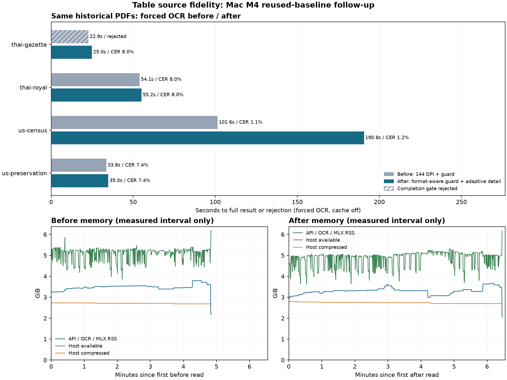

# รอบ 3c: รักษา dot leaders และรายละเอียดตารางโดยไม่แก้ค่าจากเฉลย

ก่อน `633aa9d32648e68813b33dfcdf10f54e8849a2a4`; หลัง `9859627a68a7960f575a91f50aba34107543dbda`

ใช้ baseline ใหม่ทั้ง 8 งานจากรอบ 3 ใน turn เดียวกันโดยเก็บไฟล์และ hash เดิม แล้ววัด after ใหม่บน Mac เครื่องเดิม เป็น reused-baseline follow-up ไม่ใช่ paired A/B ใหม่อีกรอบ เอกสารเดิม 4 ไฟล์ × 3 หน้า × auto/forced OCR รวม 16 timed reads ปิดแคชทั้ง document/page ผลทุกไฟล์ต้องมี source SHA-256 ตรง manifest เดิม เฉลย 24 ช่วงข้อความและ 15 แถวไม่เปลี่ยน

หลังแก้ใช้ภาพไม่เกิน 300 DPI สำหรับหน้าเล็ก/หน้ามีเส้นตาราง และคง 144 DPI สำหรับหน้าข้อความใหญ่ เลือกจาก physical geometry/preview rules ไม่ใช่ชื่อไฟล์ โดยยังอยู่ใน 12MP/20MiB ส่วนตารางหนาแน่นแบ่งเป็นช่วงตามช่องว่างของภาพ เก็บทุกพิกเซลต่อเนื่อง ไม่ซ้ำหรือข้ามช่วง แต่ละช่วงต้องจบปกติและคอลัมน์ต้องตรงกัน ถ้าไม่ตรงจะไม่ยอมรับ/ไม่ pad ค่าตัวเลข แต่ขออ่าน table crop เต็มใหม่หนึ่งครั้งและเก็บ attempt ทั้งสองไว้

ยังใช้ PaddleOCR-VL-1.6/MLX revision เดิม, 8192 tokens, serialization และ repetition guard เดิม ไม่มีการแก้ตัวเลขจาก dictionary/เฉลย ไม่มี route ตามชื่อไฟล์หรือแถวที่ใช้วัด guard ยังจับ semantic repeats 20x แต่แยก dot leaders ที่พิมพ์จริงออกจากวงจรตัวเลข โดยมี punctuation-only runaway cap 1024 อักขระ CPU/grid OCR ที่ทดลองยังไม่เปิดใน candidate นี้

ทั้งสองฝั่งใช้ max_chars=40000 และ source/page bounds เดิม รีเซ็ต MLX และอุ่นเครื่องด้วย English PNG เดียวกันก่อนแต่ละรุ่น เวลาไม่รวม upload แต่รวม render/อ่านภาพ/ประกอบผลและ polling เมื่อ detail ไม่ผ่านจึงอ่านหน้าเดิมใหม่อีกครั้งด้วย 144 DPI/baseline profile เพียงครั้งเดียว ไม่เอาผลล้มเหลวมาเปลี่ยนเป็น success เก็บทั้งสอง attempt และรวมต้นทุน retry ในเวลา ไม่ใช้ Firecrawl หรือ external upload ไม่ขึ้น main

## ข้อค้นพบและการตัดสินใจ

ราชกิจจาฯ ผ่าน completion checks ครบสามหน้าใน 25.03 วินาที แต่ sampled CER ยัง 7.99% และแถวสารบัญที่ตรงทั้งชื่อกับเลขหน้ายัง 0/6 จึงแก้การอ่านไม่จบได้ แต่ยังไม่แก้ความแม่นของสารบัญ

บังคับ OCR ส่งครบเพิ่มจาก 3/4 เป็น 4/4 ไฟล์ ส่วนแถวตารางตรงเพิ่มเพียง 3/15 เป็น 4/15 โดย Census เพิ่ม 1 แถว แต่ใช้เวลา 101.58 → 190.83 วินาที และ sampled CER 1.11% → 1.16% จึงยังไม่ใช่ความแม่นที่ดีพอสำหรับใช้งานตารางทั่วไป Royal คง CER 8.04% หลังเลิกเพิ่ม DPI ทุกหน้า

คงงานใน draft PR #3 ไม่ merge main และคืนบริการ production รุ่นเดิมแล้ว การอ่านจบไม่เท่ากับอ่านถูกทั้งหมด ผลนี้มีเพียงหนึ่ง observation ต่อเงื่อนไขและใช้ baseline รอบเดียวกันซ้ำ จึงไม่อ้างความมีนัยสำคัญทางสถิติ ดู trial ที่ยังไม่ผ่านและ CPU/grid pilots ใน ../ocr-accuracy-round3-2026-11-01/ และ ../ocr-accuracy-round3b-2026-11-02/

## เส้นทางอัตโนมัติ

| เอกสาร | ก่อน วินาที | หลัง วินาที | ส่งครบก่อน / หลัง | sampled CER ก่อน / หลัง | แถวตรงก่อน / หลัง |
|---|---:|---:|---|---|---|
| thai-gazette | 23.02 | 24.98 | ปฏิเสธ / ครบตามเกณฑ์จบ | ปฏิเสธผล / 7.99% | 0/6 / 0/6 |
| thai-royal | 53.62 | 55.30 | ครบตามเกณฑ์จบ / ครบตามเกณฑ์จบ | 8.04% / 8.04% | 0/0 / 0/0 |
| us-census | 0.23 | 0.23 | ครบตามเกณฑ์จบ / ครบตามเกณฑ์จบ | 0.67% / 0.67% | 1/6 / 1/6 |
| us-preservation | 0.32 | 0.23 | ครบตามเกณฑ์จบ / ครบตามเกณฑ์จบ | 14.09% / 14.09% | 0/3 / 0/3 |

## บังคับ OCR

| เอกสาร | ก่อน วินาที | หลัง วินาที | ส่งครบก่อน / หลัง | sampled CER ก่อน / หลัง | แถวตรงก่อน / หลัง |
|---|---:|---:|---|---|---|
| thai-gazette | 22.93 | 25.03 | ปฏิเสธ / ครบตามเกณฑ์จบ | ปฏิเสธผล / 7.99% | 0/6 / 0/6 |
| thai-royal | 54.08 | 55.24 | ครบตามเกณฑ์จบ / ครบตามเกณฑ์จบ | 8.04% / 8.04% | 0/0 / 0/0 |
| us-census | 101.58 | 190.83 | ครบตามเกณฑ์จบ / ครบตามเกณฑ์จบ | 1.11% / 1.16% | 1/6 / 2/6 |
| us-preservation | 33.79 | 35.02 | ครบตามเกณฑ์จบ / ครบตามเกณฑ์จบ | 7.45% / 7.45% | 2/3 / 2/3 |

## ภาพรวมและแรม

| รุ่น / โหมด | ส่งครบ | median วินาที รวม failures | strict rows | native RSS peak GiB |
|---|---:|---:|---|---:|
| before / auto | 3/4 | 11.67 | 1/15 | 3.49 |
| before / ocr | 3/4 | 43.94 | 3/15 | 3.80 |
| after / auto | 4/4 | 12.61 | 1/15 | 3.27 |
| after / ocr | 4/4 | 45.13 | 4/15 | 3.66 |

## รายละเอียดการ render และแบ่งตาราง

| รุ่น / โหมด / เอกสาร | DPI ต่อหน้า | จำนวน bands ต่อ table request | คอลัมน์ต่อ band |
|---|---|---|---|
| after / auto / thai-gazette | [300, 300, 300] | [] | [] |
| after / auto / thai-royal | [144, 144, 144] | [] | [] |
| after / auto / us-census | [] | [] | [] |
| after / auto / us-preservation | [] | [] | [] |
| after / ocr / thai-gazette | [300, 300, 300] | [] | [] |
| after / ocr / thai-royal | [144, 144, 144] | [] | [] |
| after / ocr / us-census | [144, 300, 300] | [3] | [[6, 6, 6]] |
| after / ocr / us-preservation | [144, 144, 144] | [] | [] |
| before / auto / thai-gazette | [] | [] | [] |
| before / auto / thai-royal | [144, 144, 144] | [] | [] |
| before / auto / us-census | [] | [] | [] |
| before / auto / us-preservation | [] | [] | [] |
| before / ocr / thai-gazette | [] | [] | [] |
| before / ocr / thai-royal | [144, 144, 144] | [] | [] |
| before / ocr / us-census | [144, 144, 144] | [] | [] |
| before / ocr / us-preservation | [144, 144, 144] | [] | [] |

## ขอบเขตและสถานะ

ส่งครบตามเกณฑ์หมายถึงไม่มีการตัด API และผ่าน completion checks ของทุกช่วงที่อ่าน ไม่ใช่คำรับรองว่าตัวอักษรถูกทั้งหมดหรือ layout พบทุกบริเวณ เก็บ page/region provenance และ metadata ทุก band ไว้ใน telemetry

sampled CER ใช้ข้อความอ้างอิงเดิม 24 ช่วง, normalization และ edlib HW เดิม ไม่ใช่ full-document CER หรือ hallucination score ทั้งเอกสาร ค่าเฉลี่ยเฉพาะไฟล์ที่ผ่านต่าง subset เปรียบเทียบตรง ๆ ไม่ได้ จึงแสดงรายไฟล์และ strict row tuples 15 แถวด้วย

Auto เอกสารอังกฤษยังใช้ text layer เดิมตาม routing; ข้อมูลใน text layer ไม่ได้ถูกนำมาเติมคำตอบ forced OCR คะแนน auto กับ forced แยกกัน ผลผิด/ถูกตัด/ไม่จบคงอยู่ในผลดิบ ไม่ทิ้ง failed outputs

แต่ละเอกสาร/โหมด/รุ่นมีหนึ่ง observation บน development corpus เดิมที่ใช้วิเคราะห์ failure ไม่ใช่ผลทางสถิติหรือ holdout การเปลี่ยน ROI/batching มีความแปรผันแม้ temperature=0 Native RSS ไม่ใช่ Metal allocation ทั้งหมด และ host memory มี background apps

CPU recognizer/grid pilots แสดงไว้แยกเพื่อบันทึกแนวทางที่ยังไม่ผ่าน: ภาพ 144 DPI และ segmentation ที่ตัดผ่านตัวเลขให้ผลผิด ข้อมูลเหล่านี้ไม่ได้ใช้เติมหรือแก้ primary output ภาพ overlay แสดงการตรวจ geometry ตัวทดลองเหล่านี้ไม่ถูกเรียกใน runtime candidate

ผลที่นำมาวัดจริงอยู่ใน results/*.json, telemetry.jsonl และ memory.jsonl; METHOD.md ตรึงวิธีวัดและ reference-lock.json ล็อกเฉลยเดิม แหล่งวิจัยอยู่ใน [SOURCES.md](../ocr-accuracy-round3-2026-11-01/SOURCES.md) งานทั้งหมดอยู่ใน branch ทดลอง ไม่มีการ merge main และคืน production ตาม restored.json
