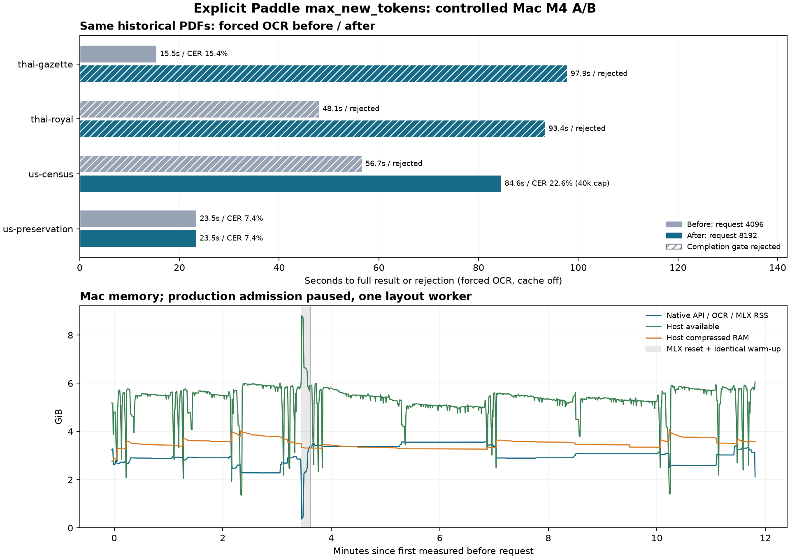

# รอบแรก: แก้เพดาน Paddle OCR 4,096 → 8,192 โทเคน

แก้ที่ pipeline.predict(max_new_tokens=8192) โดยตรง เพราะ PaddleX 3.7.2 เติมค่า 4096 เมื่อไม่ส่ง argument นี้ ค่า environment และ proxy cap เดิมจึงไม่ได้ขยายงบของ request ที่ pipeline ส่งมา เพิ่ม telemetry และแยกแคชผลที่ทำด้วยงบเดิม ไม่เปลี่ยนโมเดล ภาพ เกณฑ์จบ หรือเฉลย

A/B บน Mac เครื่องเดิม รุ่นก่อนใช้ worker ของ ac1b98b รุ่นหลังใช้ candidate Git SHA ที่บันทึกในผลดิบ ใช้ gateway รุ่นเดิมทั้งสองฝั่ง อัปโหลด PDF เดิม 4 ไฟล์ × 3 หน้าแบบ bytes ตรง manifest ปิด document/page result cache ทุกคำขอ ไม่มี Firecrawl calls

รีเซ็ต MLX ก่อนแต่ละรุ่น อุ่นเครื่องด้วย PNG ภาษาอังกฤษเดียวกัน จากนั้นอ่าน auto แล้ว forced OCR ตามลำดับเดิม จึงเทียบกับ before ใหม่เป็นหลัก ไม่เอาเวลาจาก benchmark ผ่าน public tunnel มาปะปน

## ข้อค้นพบ

ยืนยันแก้การส่งงบได้จริง: before ส่ง 4096 ส่วน after ส่ง 8192 และ Census มี generation 4782 tokens ที่จบด้วย stop จึงข้ามเพดานเดิมได้จริง แต่ยังไม่ควรใช้ 8192 เป็นงบทั่วไป: โหมด auto ผ่านจาก 3/4 เหลือ 2/4 และ forced OCR ยังผ่านเพียง 2/4 โดยสลับไฟล์ที่ผ่าน มีสแกนไทยที่ยืดไปชน 8192 แทน ทั้งนี้เป็นผล A/B ครั้งเดียว ไม่ใช่ข้อพิสูจน์ทางสถิติว่าการเพิ่มงบเป็นสาเหตุเดียวของความต่าง

Census หลังแก้จบ generation ปกติทั้งสามหน้า แต่ผลรวมมี HTML มากจนยาว 119,641 อักขระ API จึงตัดที่ 40,000 ตามขีดจำกัดเดิม ทำให้ CER ของข้อความที่ส่งจริงเป็น 22.64% เมื่อวิเคราะห์ผลเต็มก่อนตัดจาก observer แยกต่างหาก sampled CER เป็น 1.50% และแถวตรง 1/6 ข้อนี้แสดงปัญหาการส่งผล downstream เพิ่มจาก token budget ไม่ได้แก้ขีดจำกัดอักขระระหว่างทดลอง

การตัดสินใจ: เก็บ patch และหลักฐานใน PR โดยยังไม่ promote candidate นี้ขึ้น main เพราะผลเส้นทางอัตโนมัติในชุดทดลองถอยลง คืนบริการ production รุ่น ac1b98b แล้ว การรับค่า token budget ถูกแก้ใน candidate แต่การเพิ่มงบทั่วระบบยังไม่ถือว่าผ่าน quality acceptance

## ผลรายเอกสาร

### เส้นทางอัตโนมัติ

| เอกสาร 3 หน้า | ก่อน วินาที | หลัง วินาที | ก่อน sampled CER ↓ | หลัง sampled CER ↓ | แถวตรงก่อน / หลัง | length stops ก่อน / หลัง |
|---|---:|---:|---|---|---|---|
| thai-gazette | 15.40 | 97.87 | 16.33% | ปฏิเสธผล | 0/6 / 0/6 | 0 / 1 |
| thai-royal | 47.20 | 93.74 | ปฏิเสธผล | ปฏิเสธผล | 0/0 / 0/0 | 1 / 1 |
| us-census | 0.22 | 0.23 | 0.67% | 0.67% | 1/6 / 1/6 | 0 / 0 |
| us-preservation | 0.22 | 0.23 | 14.09% | 14.09% | 0/3 / 0/3 | 0 / 0 |

### บังคับ OCR ทุกหน้า

| เอกสาร 3 หน้า | ก่อน วินาที | หลัง วินาที | ก่อน sampled CER ↓ | หลัง sampled CER ↓ | แถวตรงก่อน / หลัง | length stops ก่อน / หลัง |
|---|---:|---:|---|---|---|---|
| thai-gazette | 15.48 | 97.85 | 15.42% | ปฏิเสธผล | 0/6 / 0/6 | 0 / 1 |
| thai-royal | 48.08 | 93.42 | ปฏิเสธผล | ปฏิเสธผล | 0/0 / 0/0 | 1 / 1 |
| us-census | 56.71 | 84.63 | ปฏิเสธผล | 22.64%* | 0/6 / 0/6 | 1 / 0 |
| us-preservation | 23.47 | 23.45 | 7.45% | 7.45% | 2/3 / 2/3 | 0 / 0 |

## ภาพรวมและแรม

| รุ่น / โหมด | ผ่าน | median วินาที รวมผลปฏิเสธ | CER เฉพาะผลที่ผ่าน ↓ | native RSS peak GiB | available ต่ำสุด GiB | compressor peak GiB |
|---|---:|---:|---|---:|---:|---:|
| before / auto | 3/4 | 7.81 | 10.36% | 2.91 | 2.08 | 3.59 |
| before / ocr | 2/4 | 35.78 | 11.43% | 2.97 | 1.35 | 4.03 |
| after / auto | 2/4 | 46.99 | 7.38% | 3.56 | 2.33 | 3.46 |
| after / ocr | 2/4 | 89.02 | 15.04% | 3.58 | 1.41 | 4.09 |

## ขอบเขตการตีความ

เครื่องหมาย * คือ API ตัดผลตามขีดจำกัด 40,000 อักขระที่ตรึงไว้เหมือนกันทั้งสองรุ่น แม้ reader คืน ok=true จึงไม่ถือว่าเป็นหลักฐานว่าส่ง transcript ครบทุกหน้า ดู output_truncated ใน analysis.json

ดู sent_limits ใน analysis.json และ telemetry.jsonl เพื่อยืนยันงบจริง ไม่ตัดสินจากชื่อ config หรือความยาว output เพียงอย่างเดียว max_generated_tokens และ finish reason ระบุแยกต่อเอกสาร/บริเวณ

sampled CER ใช้ 24 ช่วงข้อความและ strict row tuples 15 แถวเดิม ด้วย normalization/edlib HW แบบเดิม ไม่ใช่ CER ทั้งเอกสาร การหา best substring ไม่วัด hallucination นอกช่วงอ้างอิง เฉลยเป็น single-reviewer pilot ไม่มีการเปลี่ยนตามผลใหม่

ผลถูกปฏิเสธไม่มี accepted CER; delivery_penalty_pct ให้โทษ 100% สำหรับผลที่ส่งไม่ได้เพื่อไม่ตัด failure ออก เก็บข้อความของหน้าที่ถูกปฏิเสธใน telemetry เพื่อวิเคราะห์ได้ แต่ไม่นับเป็น transcript ที่ผ่าน

ในโหมด auto เอกสารอังกฤษใช้ text layer เดิม จึงไม่ใช่ความเร็ว/ความแม่นของ recognition ใหม่ ต้องดูตาราง forced OCR ประกอบ ค่าเฉลี่ย accepted CER ของสองรุ่นอาจเป็นคนละ subset จึงต้องเทียบรายเอกสารด้วย

วัดครั้งเดียวต่อเอกสาร/โหมด/รุ่น ไม่ใช่ผลทางสถิติ และบริการ MLX batch บริเวณภาพอาจให้ผลต่างกันแม้ temperature=0 ผลก่อนในรอบนี้อาจต่างจากประวัติเดิม การเพิ่มงบโทเคนจึงไม่เท่ากับรับประกันความแม่นหรือความครบ

RAM sampled ทุก 0.5 วินาที: RSS รวม native API/OCR/MLX อาจนับ shared pages ซ้ำและไม่ใช่ Metal allocation ทั้งหมด available/compressor เป็นของทั้งเครื่องพร้อม background apps ไม่ใช่ hard isolation แยกค่า bracketed สำหรับงานสั้นกว่า sample interval

ช่วงทดสอบพักรับงาน production และหยุด worker OCR เดิมเพื่อลดการแย่งทรัพยากร หลังจบตรวจ restored.json ว่าเปิดบริการเดิมและ deploy controller กลับแล้ว ไม่มีการนำ candidate ขึ้น main ระหว่างวัด

ไฟล์สำคัญ: METHOD.md, run_ab.py, observe_worker.py, results/analysis.json, telemetry.jsonl, memory.jsonl และผลดิบก่อน–หลัง 16 คำขอ เฉลยและ source manifest อยู่ใน ../real-history-2026-11-01/
