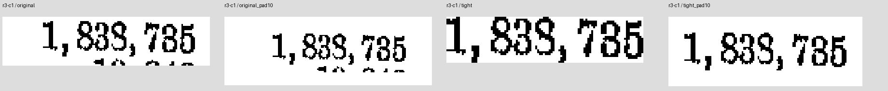
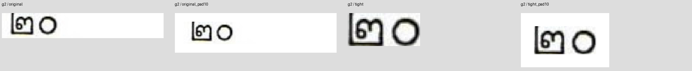

# รอบ 6: ตรวจเฉลย แล้วแยกผลกรอบ crop กับขอบขาว

**เติมขอบขาวช่วย Tesseract ในเลขไทยบางช่อง แต่ยังไม่ใช่การปรับที่ดีขึ้นทุกช่อง** คะแนนเลขไทยเพิ่มจาก 1/6 เป็น 2/6 ขณะที่ช่องที่เคยถูกบางช่องเสียไป หากดูเกณฑ์รวมเดิมเก้าภาพยังถูก 2/9 เท่าเดิมแต่คนละช่อง กรอบกระชับโดยไม่มีขอบขาวแย่ลง VLM ไม่ได้ดีขึ้นในสี่แบบนี้ ไม่มีการเปิดใช้ใน pipeline หรือขึ้น main

## ตรวจเฉลยก่อนรัน

ตรวจ SHA ของ PDF subset เดิม แล้วดูภาพต้นฉบับเต็มแถว/คอลัมน์และภาพขยายจากไฟล์นั้นก่อนตรึงข้อมูลใหม่ เลขไทยทั้งหกคือ `๑, ๒๐, ๒๘, ๓๑, ๙๔, ๑๕๙` ยืนยันจากภาพได้ **ไม่มีการเปลี่ยนค่าตัวเลขในเฉลยเดิม**

สามช่อง Census มีปัญหาคนละระดับ: ค่าที่ตั้งใจรายงานได้รับการยืนยันด้วยตารางทางการอีกชุด แต่รูปร่าง glyph ในภาพทดสอบยังแยก 5/6 หรือ 3/8 ยาก จึงไม่อ้างว่าภาพทั้งสามอ่านได้ชัดแน่นอน และไม่แก้เฉลยไปตามเสียงส่วนใหญ่ของ OCR รอบนี้ใช้เลขไทยหกช่องเป็น primary pixel-accuracy และรายงานสาม Census เป็นคะแนนเทียบ intended value แยกต่างหาก

| ช่อง | ค่าอ้างอิงคงเดิม | สถานะตรวจ | หลักฐาน |
|---|---|---|---|
| g1 | ๑ | ยืนยันจากภาพ | [ภาพบริบท](evidence/g1-context600.png) |
| g2 | ๒๐ | ยืนยันจากภาพ | [ภาพบริบท](evidence/g2-context600.png) |
| g3 | ๒๘ | ยืนยันจากภาพ | [ภาพบริบท](evidence/g3-context600.png) |
| g4 | ๓๑ | ยืนยันจากภาพ | [ภาพบริบท](evidence/g4-context600.png) |
| g5 | ๙๔ | ยืนยันจากภาพ | [ภาพบริบท](evidence/g5-context600.png) |
| g6 | ๑๕๙ | ยืนยันจากภาพ | [ภาพบริบท](evidence/g6-context600.png) |
| r1-c3 | 59,135 | ค่ามีหลักฐานเทียบ; glyph ในสแกนยังคลุมเครือ | [ภาพบริบท](evidence/r1-c3-context600.png); [ตารางทางการอีกชุด](https://www2.census.gov/library/publications/decennial/1890/bulletins/demographics/145-population-of-il.pdf) |
| r3-c1 | 1,838,735 | ค่ามีหลักฐานเทียบ; glyph ในสแกนยังคลุมเครือ | [ภาพบริบท](evidence/r3-c1-context600.png); [ตารางทางการอีกชุด](https://www2.census.gov/library/publications/decennial/1910/bulletins/demographics/360-population-by-counties-minor-civil-divisions-1910-1900-1890-part-1.pdf) |
| r4-c5 | 13,282 | ค่ามีหลักฐานเทียบ; glyph ในสแกนยังคลุมเครือ | [ภาพบริบท](evidence/r4-c5-context600.png); [ตารางทางการอีกชุด](https://www2.census.gov/library/publications/decennial/1860/statistics/1860d-13.pdf) |

แหล่งไทยที่ใช้ชื่อ ID ว่า thai-gazette คือหนังสือประมวลประกาศ รัชกาลที่ ๔ เล่ม ๓ ฉบับรวมพิมพ์ภายหลัง PDF หน้า 6–8 จากกรมศิลปากร ไม่ใช่แผ่นราชกิจจาฯ ศตวรรษที่ 19 ภาพ 600 DPI ใน evidence เป็นการขยายเพื่อดู ไม่ได้สร้างรายละเอียดที่หายไป และข้อความ OCR เก่าที่ฝังใน PDF ไม่ถูกใช้เป็นเฉลย

ภาพแถวเต็มเพื่อดูชื่อแถวและลำดับช่อง: [Adams](evidence/adams-full-row600.png), [Cook](evidence/cook-full-row600.png), [Woodford](evidence/woodford-full-row600.png) เก็บจากภาพต้นฉบับก่อนการทดลอง ไม่ใช่ภาพที่ผ่านตัวอ่าน

## การทดลองสี่แบบ

- เดิม: PNG round 5 เดิมทุกไบต์
- เดิม + ขาว: เพิ่มขอบขาว 10 พิกเซลรอบภาพ
- กระชับ: หากลุ่มหมึกหลักด้วยกฎ component ที่ตรึงไว้ เลือกกรอบบรรทัดตัวเลข ตัดขอบว่าง/เศษแถวข้างเคียงนอกกรอบ
- กระชับ + ขาว: กรอบเดียวกับข้อก่อน แล้วเพิ่มขาว 10 พิกเซล

ไม่มี resize, sharpen, แต่งเส้น หรือลบ pixel ภายในกรอบที่เก็บไว้ ใช้ threshold เฉพาะหา geometry ภาพอ่านจริงคงค่าสีเดิม กรอบใหม่ของ Cook เอาเศษแถว Crawford ที่ติดขอบล่างออกได้ ตัวอย่างนี้ถูกตรวจด้วยภาพก่อนรัน ไม่ได้เลือกกรอบจากการรู้ว่าผลใดจะตรงเฉลย

## ความแม่นและความเร็ว

รันบน Mac M4 เดิม โมเดล/weights/prompt/ภาษาเหมือนรอบ 5 ตัวละหนึ่งรอบแรกและสาม warm passes ให้ข้อความเหมือนกันทุกรอบ ทุกคำตอบจบตาม completion checks แต่การจบไม่ได้แปลว่าอ่านถูก ทั้ง 36 PNG ใช้เหมือนกันระหว่างสอง reader และไม่ส่งเฉลยเข้า prompt

| ตัวอ่าน | กรอบ | เลขไทยชัด /6 | Census เทียบค่าอ้างอิง /3* | median ต่อภาพ (ms) | median รวมเก้าภาพ (s) |
|---|---|---:|---:|---:|---:|
| VLM เดิม | เดิม | 0/6 | 0/3 | 306.84 | 2.859 |
| VLM เดิม | เดิม + ขาว 10px | 0/6 | 0/3 | 317.15 | 2.856 |
| VLM เดิม | กรอบกระชับ | 0/6 | 0/3 | 309.27 | 2.860 |
| VLM เดิม | กระชับ + ขาว 10px | 0/6 | 0/3 | 327.19 | 2.836 |
| Tesseract best / PSM 7 | เดิม | 1/6 | 1/3 | 20.12 | 0.284 |
| Tesseract best / PSM 7 | เดิม + ขาว 10px | 2/6 | 0/3 | 18.31 | 0.272 |
| Tesseract best / PSM 7 | กรอบกระชับ | 0/6 | 0/3 | 20.09 | 0.287 |
| Tesseract best / PSM 7 | กระชับ + ขาว 10px | 2/6 | 0/3 | 18.49 | 0.274 |

*สาม Census ไม่ถูกนับรวมเป็น primary pixel-accuracy เพราะภาพยังคลุมเครือ ถึงแม้ค่าอ้างอิงจะมีหลักฐานทางการสนับสนุน การเปรียบเทียบเก้าภาพทั้งหมดตาม legacy reference ยังอยู่ใน analysis แต่ไม่ใช้ปะปนกับหกภาพที่ยืนยันได้

เวลาเป็นผลรวมเวลาเรียกอ่านภาพที่เตรียมไว้แล้ว ไม่รวมขั้นสร้าง crop หรือติดตั้ง/โหลดเครื่องมือ เทียบ reader API เดิม: VLM เป็น native server; Tesseract เป็น CLI จึงรวมการสร้างโปรเซสและโหลด language data ต่อภาพ ใช้ median ของผลรวมเก้าภาพจากสาม warm passes ไม่อ้างอัตราเร่งทั้ง PDF หรือความต่างไม่กี่ ms ว่ามีนัยสำคัญ

## แรมและเวลาเริ่มต้น

| ตัวอ่าน | reader-phase RSS peak | startup ภายใน worker | หมายเหตุ |
|---|---:|---:|---|
| VLM เดิม | 2122.5 MiB | 3.563s | รวม native MLX + worker; import/warmup ใน worker แยกจาก server ready |
| Tesseract best / PSM 7 | 110.2 MiB | รวมใน CLI แต่ละภาพ | รวม wrapper + subprocess; child peak ตรวจด้วย /usr/bin/time -l |

RSS ไม่ใช่ unified memory/Metal allocation ทั้งหมด อาจนับ shared pages ซ้ำ เริ่มจับ VLM หลัง server พร้อม จึงไม่ครอบคลุม peak ก่อน server ready และ RAM ที่ค้างจากคำสั่งก่อนหน้าอาจอยู่ในช่วงของ variant ถัดไป ไม่ใช้สรุปว่ากรอบใดประหยัดแรมกว่าอย่างเป็นเหตุเป็นผล ข้อมูล peak ใน call windows ของแต่ละ variant อยู่ใน analysis.json

CPU phase ปลด MLX ออกก่อนวัด ไม่มี inference ซ้อนกัน Sampling ขอทุก 20ms ช่วงห่างจริงสูงสุดประมาณ 55ms; Tesseract มีค่าจุดสูงสุดจากระบบต่อ subprocess เป็นหลักฐานเสริม Swap ที่ใช้อยู่ก่อนหน้าไม่เพิ่มระหว่างสอง reader phases คืน supervisor และบริการ production หลังจบแล้ว

## เปลี่ยนช่องไหนบ้าง

Tesseract เดิมอ่านเลข `๓๑` และ Woodford `13,282` ตรงค่าอ้างอิง แต่เติมขอบขาวกลับอ่านสองช่องนี้ผิด และได้ `๑` กับ `๒๐` ถูกแทน จึงไม่ใช่ชนะทุกช่อง ทั้งกรอบเดิม+ขาวและกระชับ+ขาวได้เลขไทย 2/6 เหมือนกัน ส่วนกระชับอย่างเดียวได้ 0/6

| ตัวอ่าน / ช่อง | ค่าอ้างอิง | เดิม | เดิม+ขาว | กระชับ | กระชับ+ขาว |
|---|---|---|---|---|---|
| VLM เดิม / g1 | ๑ | ⑨ | ⑨ | ⑥ | ③ |
| VLM เดิม / g2 | ๒๐ | 30 | ๑๐ | 30 | ౦௰ |
| VLM เดิม / g3 | ๒๘ | 33 | ๒๙ | 33 | ఆ |
| VLM เดิม / g4 | ๓๑ | मॅ | ตอ | m⑨ | ต่อ |
| VLM เดิม / g5 | ๙๔ | ཨུ | อ๖ | a | ཤཱི |
| VLM เดิม / g6 | ๑๕๙ | ༢༤་༤ | อดีต | ༢༤་༤ | ఐడిఐ |
| VLM เดิม / r1-c3 | 59,135 | 69,135 | 69,135 | 69,135 | 69, 135 |
| VLM เดิม / r3-c1 | 1,838,735 | 1,833,735 | 1,833,735 | 1,839,735 | 1,839,785 |
| VLM เดิม / r4-c5 | 13,282 | 18,282 | 18,282 | 18,282 | 18, 282 |
| Tesseract best / PSM 7 / g1 | ๑ | อ | ๑ ✓ | อ | ๑ ✓ |
| Tesseract best / PSM 7 / g2 | ๒๐ | ๒๓๐ | ๒๐ ✓ | ๆ ๐ | ๒๐ ✓ |
| Tesseract best / PSM 7 / g3 | ๒๘ | ๒๓๕๐ | ๒๕ | เ๒ๆ 6 | ๒๕ |
| Tesseract best / PSM 7 / g4 | ๓๑ | ๓๑ ✓ | ๓อ๑ | 6\| \| 6@) | ๓อ๑ |
| Tesseract best / PSM 7 / g5 | ๙๔ | ๕๕ | ฒณ๕ | ค4๕6ส | ฒ๕ |
| Tesseract best / PSM 7 / g6 | ๑๕๙ | ๑๕๓ | ๑๕๕ | ๑๕@ | ๑๕๕ |
| Tesseract best / PSM 7 / r1-c3 | 59,135 | 69,185 | 69,135 | HO, 135 | 69,135 |
| Tesseract best / PSM 7 / r3-c1 | 1,838,735 | 1,838,785 | 1,838,785 | 1,838, 785 | 1,838,785 |
| Tesseract best / PSM 7 / r4-c5 | 13,282 | 13,282 ✓ | 18, 282 | 13, 232 | 18,282 |

## ข้อสรุปและขอบเขต

การเติม border มีผลกับ segmentation/คำตอบของ Tesseract จริง แต่ยังไม่มี configuration เดียวที่แม่นพอเปิดอัตโนมัติ การตัดขอบให้ชิดที่สุดไม่ได้ช่วยโดยตัวมันเอง และ VLM เดิมไม่ได้กู้เลขไทยชุดนี้ด้วยการเปลี่ยนกรอบทั้งสี่แบบ ควรเก็บผลนี้เป็นข้อจำกัดของชุดภาพ/การอ่านร่วมกัน ไม่กล่าวโทษโมเดลล้วน ๆ จากสาม glyph ที่กำกวม และไม่รวมคำตอบแต่ละกรอบที่ตรงเฉลยมาอ้างเป็นระบบ ensemble ที่ทำงานจริง

นี่เป็น development-set ablation ที่รู้ failure เก่าแล้ว มี unique cases 9 ช่อง ไม่ใช่ holdout แม้อ่านซ้ำ 288 ครั้งผลนิ่งก็ตาม ไม่มีการหาค่าขอบ/threshold จากผล OCR ทีละช่อง ต้องมีชุดเอกสารยืนยันแยกก่อนเลือกนโยบาย preprocessing

[METHOD.md](METHOD.md) ตรึงวิธี, [reference-audit.json](reference-audit.json) แยกสถานะเฉลย, [inputs.json](inputs.json) ล็อกกรอบ/PNG hash, [analysis.json](analysis.json) เก็บผลทุก pass และเวลา, [validation.json](validation.json) ตรวจว่าพิกเซลภายในกรอบ/ขอบขาวตรงตามกฎและ control เดิมตรง round 5 ทุกตัว แฟ้ม PDF/weights ต้นฉบับอยู่นอก Git

งานทั้งหมดอยู่ใน branch ทดลอง ไม่มี runtime pipeline change หรือ main merge บริการ Mac คืน `ac1b98b` แล้ว ไม่ใช้ Firecrawl และไม่มี external document upload
