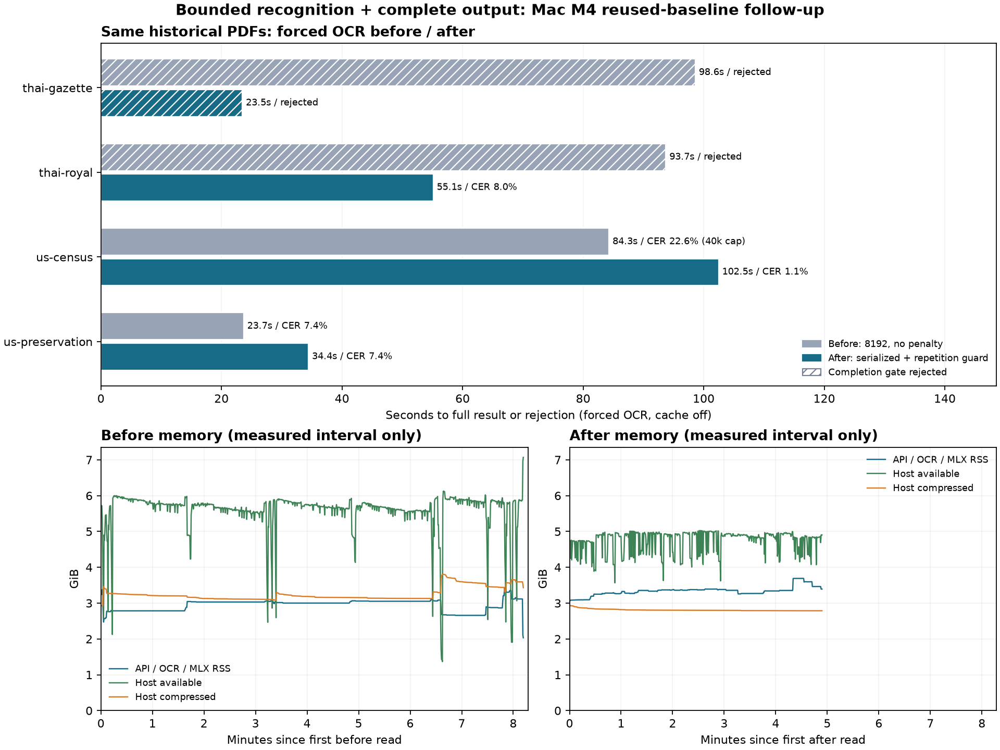

# รอบสองผลสุดท้าย: ตัดวงจรวนซ้ำและส่งผลครบอย่างตรงไปตรงมา

Before `27466cae9c17ab3427295d0c64cc1b93556e551c`; after `bfa295e0b9de2b07df236bd242890f76ce8d0423`

เอกสารเดิม 4 ไฟล์ ไฟล์ละ 3 หน้า: auto และ forced OCR รวม 16 คำขอ timed ปิด result cache ทั้งหมด รีเซ็ต MLX/อุ่นเครื่องแบบเดิมก่อนแต่ละรุ่น ไม่มี Firecrawl ไม่ขึ้น main

Before เป็น candidate 8,192 โทเคนของรอบแรก ไม่ใช่ production 4,096 รุ่นเก่า ใช้ baseline สดทั้ง 8 งานจากรอบสองใน turn เดียวกันโดยเก็บไฟล์เดิมทุก byte; after วัดใหม่หลัง probe และรีเซ็ต MLX จึงเป็น reused-baseline follow-up ไม่ใช่ fully paired A/B ใหม่

After ส่ง repetition_penalty=1.0/context=64 และ serialize requests พร้อม stream guard ตามเกณฑ์ซ้ำเดิม โดยยังใช้ 8192 โทเคน ไม่ลบข้อความซ้ำ ไม่ผ่อน completion checks และลด presentation attributes ใน HTML ตารางโดยคงข้อความ/เซลล์/rowspan/colspan ส่วน API เพิ่ม max_chars=0 เพื่อส่งครบ และ output_complete สำหรับแยก preview

Primary A/B ยังคง max_chars=40000 ทั้งสองฝั่ง การส่งครบในผลนี้จึงต้องเกิดภายในงบเท่ากัน ไม่ใช่เพิ่มเพดานเฉพาะ after

## ข้อค้นพบ

เพิ่มการตัดวงจรวนซ้ำระหว่างรับ SSE โดยปิด HTTP stream เมื่อเข้าเกณฑ์ซ้ำเดิม ไม่แปลงผลที่ถูกยกเลิกให้เป็น success และไม่เอาข้อความผิดหลัง padding มาใช้แทนข้อความจริง หลักฐาน backend cancellation แยกใน backend-cancellations.log

การส่ง recognition ทีละรายการช่วยให้ Thai royal จบครบในชุดนี้ ส่วน Gazette ยังมี crop ที่โมเดลอ่านผิดและวนเลขศูนย์ ตัว guard ลดเวลาที่เสียแต่เอกสารยังเป็นผลปฏิเสธ ไม่ใช่ OCR ที่แก้ความแม่นสำเร็จ

Census ส่งข้อความครบหลัง compact HTML โดยไม่เปลี่ยนเนื้อหา/เซลล์/การรวมช่อง และ API มี max_chars=0 เพื่อส่งครบ selected pages ในการใช้จริง Primary benchmark ยังคง max_chars=40000 ทั้งสองฝั่ง

ยังไม่ merge main: งานส่งครบมากขึ้น แต่ Gazette ยังไม่ผ่านและ strict table rows ยังต่ำ บริการ production คืน ac1b98b ตาม restored.json ผลการทดสอบเป็น pilot บนชุดเดียวที่ใช้วิเคราะห์ failure ไม่ใช่การยืนยันทั่วไปกับเอกสารใหม่

## เส้นทางอัตโนมัติ

| เอกสาร | ก่อน วินาที | หลัง วินาที | ส่งครบก่อน / หลัง | sampled CER ก่อน / หลัง | แถวตรงก่อน / หลัง | length stops ก่อน / หลัง |
|---|---:|---:|---|---|---|---|
| thai-gazette | 97.72 | 23.37 | ปฏิเสธ / ปฏิเสธ | ปฏิเสธผล / ปฏิเสธผล | 0/6 / 0/6 | 1 / 0 |
| thai-royal | 92.56 | 54.69 | ปฏิเสธ / ครบตามเกณฑ์จบ | ปฏิเสธผล / 8.04% | 0/0 / 0/0 | 1 / 0 |
| us-census | 0.24 | 0.22 | ครบตามเกณฑ์จบ / ครบตามเกณฑ์จบ | 0.67% / 0.67% | 1/6 / 1/6 | 0 / 0 |
| us-preservation | 0.22 | 0.22 | ครบตามเกณฑ์จบ / ครบตามเกณฑ์จบ | 14.09% / 14.09% | 0/3 / 0/3 | 0 / 0 |
## บังคับ OCR

| เอกสาร | ก่อน วินาที | หลัง วินาที | ส่งครบก่อน / หลัง | sampled CER ก่อน / หลัง | แถวตรงก่อน / หลัง | length stops ก่อน / หลัง |
|---|---:|---:|---|---|---|---|
| thai-gazette | 98.60 | 23.46 | ปฏิเสธ / ปฏิเสธ | ปฏิเสธผล / ปฏิเสธผล | 0/6 / 0/6 | 1 / 0 |
| thai-royal | 93.71 | 55.12 | ปฏิเสธ / ครบตามเกณฑ์จบ | ปฏิเสธผล / 8.04% | 0/0 / 0/0 | 1 / 0 |
| us-census | 84.28 | 102.47 | ถูกตัด / ครบตามเกณฑ์จบ | 22.64% / 1.11% | 0/6 / 1/6 | 0 / 0 |
| us-preservation | 23.67 | 34.42 | ครบตามเกณฑ์จบ / ครบตามเกณฑ์จบ | 7.45% / 7.45% | 2/3 / 2/3 | 0 / 0 |

## สรุปและหน่วยความจำ

| รุ่น / โหมด | reader ok | ส่งครบ | median วินาทีรวม failures | penalty-inclusive CER | แถวตรง | native RSS peak GiB |
|---|---:|---:|---:|---:|---|---:|
| before / auto | 2/4 | 2/4 | 46.40 | 53.69% | 1/15 | 3.39 |
| before / ocr | 2/4 | 1/4 | 88.99 | 57.52% | 2/15 | 3.42 |
| after / auto | 3/4 | 3/4 | 11.80 | 30.70% | 1/15 | 3.33 |
| after / ocr | 3/4 | 3/4 | 44.77 | 29.15% | 3/15 | 3.69 |

## การยกเลิกวงจรวนซ้ำ

| รุ่น / โหมด / ไฟล์ | guard cancellations | natural length stops | calls ที่ไม่มี final token usage |
|---|---:|---:|---:|
| after / auto / thai-gazette | 1 | 0 | 1 |
| after / auto / thai-royal | 0 | 0 | 0 |
| after / ocr / thai-gazette | 1 | 0 | 1 |
| after / ocr / thai-royal | 0 | 0 | 0 |
| after / ocr / us-census | 0 | 0 | 0 |
| after / ocr / us-preservation | 0 | 0 | 0 |
| before / auto / thai-gazette | 0 | 1 | 0 |
| before / auto / thai-royal | 0 | 1 | 0 |
| before / ocr / thai-gazette | 0 | 1 | 0 |
| before / ocr / thai-royal | 0 | 1 | 0 |
| before / ocr / us-census | 0 | 0 | 0 |
| before / ocr / us-preservation | 0 | 0 | 0 |

Guard ที่ยกเลิกก่อน packet usage เก็บ completion_tokens=null ไม่ได้นับเป็นศูนย์ ค่าจำนวนโทเคนสูงสุดใน analysis เป็นเฉพาะค่าที่ upstream รายงาน ส่วนจำนวนที่ backend ยกเลิกจริงตรวจใน log แยก Guard นับแยกจาก length stop ตามธรรมชาติ

## การตรวจผล

| รุ่น / โหมด / ไฟล์ | chars ส่งจริง | API ตัด | normal pages | regions ต่อหน้าที่สังเกต | งบส่งจริง | penalty ส่งจริง |
|---|---:|---|---:|---|---|---|
| after / auto / thai-gazette | 0 | False | 2 | [13, 12, 12] | [8192] | [1.0] |
| after / auto / thai-royal | 5406 | False | 3 | [5, 3, 7] | [8192] | [1.0] |
| after / auto / us-census | 23185 | False | 0 | [] | [] | [] |
| after / auto / us-preservation | 7993 | False | 0 | [] | [] | [] |
| after / ocr / thai-gazette | 0 | False | 2 | [13, 12, 12] | [8192] | [1.0] |
| after / ocr / thai-royal | 5406 | False | 3 | [5, 3, 7] | [8192] | [1.0] |
| after / ocr / us-census | 27657 | False | 3 | [13, 8, 11] | [8192] | [1.0] |
| after / ocr / us-preservation | 10508 | False | 3 | [11, 7, 12] | [8192] | [1.0] |
| before / auto / thai-gazette | 0 | False | 2 | [13, 12, 12] | [8192] | [None] |
| before / auto / thai-royal | 0 | False | 0 | [5] | [8192] | [None] |
| before / auto / us-census | 23185 | False | 0 | [] | [] | [] |
| before / auto / us-preservation | 7993 | False | 0 | [] | [] | [] |
| before / ocr / thai-gazette | 0 | False | 2 | [13, 12, 12] | [8192] | [None] |
| before / ocr / thai-royal | 0 | False | 0 | [5] | [8192] | [None] |
| before / ocr / us-census | 40000 | True | 3 | [13, 8, 11] | [8192] | [None] |
| before / ocr / us-preservation | 21287 | False | 3 | [11, 7, 12] | [8192] | [None] |

## ขอบเขตการแปลผล

ส่งครบตามเกณฑ์จบหมายถึง reader ok ไม่มีการตัดตัวอักษร และ OCR ผ่าน completion checks; ไม่ได้รับประกันว่าถอดทุกคำถูกหรือ layout ตรวจพบทุกบริเวณ เก็บ page/region provenance ใน telemetry และเทียบจำนวนบริเวณประกอบ ผล reject ไม่ถูกนับเป็น transcript ผ่าน

sampled CER คือ 24 ช่วงข้อความอ้างอิงเดิม ใช้ normalization/edlib HW เดิม ไม่ใช่ CER ทั้งเอกสารหรือคะแนนตรวจ hallucination ทุกจุด ตารางใช้ strict row tuples 15 แถวเดิม ไม่มีการเปลี่ยนเฉลยตามผลทดลอง ผลที่ reader ปฏิเสธมี penalty 100% ส่วน output ที่ถูก API ตัดคงแสดงคะแนนของข้อความที่ส่งจริงและทำเครื่องหมายไม่ครบ

Auto อังกฤษใช้ text layer จึงไม่ใช่ความเร็ว recognition ใหม่ Median รวม failures; accepted CER เปรียบเทียบได้เฉพาะเอกสารเดียวกัน ไม่ใช้ค่าเฉลี่ยคนละ subset สรุปว่าดีขึ้น

เป็น A/B ครั้งเดียวต่อเอกสาร/โหมด ไม่ใช่ข้อสรุปทางสถิติ MLX region batching มีความแปรผันแม้ temperature=0 Native RSS ไม่ใช่ Metal allocation ทั้งหมดหรือ RAM เฉพาะโมเดล และ host memory มี background apps

../ocr-repeat-round2-2026-11-01/compaction-replay.json เป็นการพิสูจน์แยกบน Census ของรอบแรกว่า plain text และโครงสร้างตารางไม่เปลี่ยนจากการตัด presentation attributes ไม่ใช่การอนุมานใหม่หรือเอาผลเก่ามาแทนผล benchmark

ยังไม่ขึ้น main ระหว่างการทดลอง ต้องประเมินคุณภาพจากหลักฐานก่อน Production คืนรุ่นเดิมตาม restored.json

ไฟล์หลัก: METHOD.md, run_ab.py, observe_worker.py, analyze.py, results/*.json, telemetry.jsonl, memory.jsonl; reference-lock.json ล็อกเฉลยเดิม
