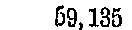
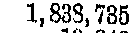
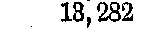

# รอบ 4: แยกแถวตารางได้ แต่เลขหน้าราชกิจจาฯ ยังไม่ผ่าน

**แก้ San Diego Sun ที่ถูกรวมแถวได้แล้ว ส่วนทางอ่านเลขหน้าราชกิจจาฯ ใหม่ยังไม่แม่นพอ จึงปิดไว้เป็นโหมดทดลอง โมเดลเดิมอ่าน crop ตัวเลข Census ได้ 17/20 ช่อง เทียบกับทั้งตาราง 11/20 ช่อง** ยังไม่ได้เปรียบเทียบโมเดลอื่น จึงยังสรุปไม่ได้ว่าการเปลี่ยนโมเดลจะชนะ

## ผล pipeline สองเอกสารเป้าหมาย

เปรียบเทียบผลเดิมรอบ 3c (`9859627`) กับการยืนยันรุ่นสุดท้ายรอบ 4g (`1a45c4d`) บน Mac M4 เครื่องเดิม ปิด cache ทั้งสองระดับ เอกสารเดิมไฟล์ละสามหน้า เฉลยเดิมไม่เปลี่ยน ก่อนแก้เป็นผลบันทึกเดิม ไม่ใช่ fresh paired A/B รอบใหม่

| เอกสาร | เวลา ก่อน → หลัง | แถวตรง ก่อน → หลัง | sampled CER ก่อน → หลัง | ส่งครบหลัง |
|---|---:|---:|---:|---|
| thai-gazette | 25.03 → 25.00 วินาที | 0/6 → 0/6 | 7.99% → 7.99% | ครบตาม completion checks |
| us-preservation | 35.02 → 39.16 วินาที | 2/3 → 3/3 | 7.45% → 0.39% | ครบตาม completion checks |

San Diego Sun ถูกคืนเป็น `<tr>` ของตัวเอง: `San Diego Sun | Oct. 31, 1872 | ว่าง | ว่าง | 100 | 1` ไม่ปน Portland Oregonian แล้ว

วิธีแก้แบ่ง shallow table ตามบรรทัดในภาพ เก็บช่วงภาพทุกพิกเซลต่อเนื่อง กรณีสุดท้ายเป็นแถวสรุปและจำนวนเซลล์ไม่เท่ากัน จะยอมใช้โครงสร้างจากการอ่านตารางเต็มใหม่ได้เฉพาะเมื่อข้อความ/ค่าที่ไม่ว่างตรงกันทุกช่องและมีเพียงหนึ่งแถวที่ตรง ณ ความกว้างคอลัมน์ของแถวก่อนหน้า จึงเก็บสองแถวข้อมูลที่อ่านแยกไว้ และใช้แถวสรุปที่มีโครงสร้างจาก full read จริง ไม่สร้างช่องว่างหรือแก้ตัวเลขเอง เก็บทั้งสองกลยุทธ์และค่าใช้จ่ายใน `table_attempts`

## Census: ทั้งตาราง เทียบ crop แถว และ crop เซลล์

การทดลองนี้ใช้พิกัดที่ตรวจภาพด้วยมือของสี่แถวที่เคยตก: Adams, Alexander, Cook, Woodford เป็น **oracle-crop diagnostic** ไม่ใช่ผล pipeline อัตโนมัติ อ่านยี่สิบช่องแรกของสี่แถว รวมเก้าช่องเดิมที่ผิดและสิบเอ็ดช่องควบคุมที่เดิมถูก ใช้โมเดล/revision เดิม, temperature 0, 8192 tokens และ source pixels 300 DPI เดียวกัน ไม่ resize/ล้างภาพหรือส่งชื่อ/ค่าจากเฉลยเข้า prompt การให้คะแนนเกิดหลังอ่านเสร็จเท่านั้น

| วิธี | ช่องถูก/20 | แก้ช่องเดิมที่ผิดได้/9 | รักษาช่องควบคุม/11 | เวลาเฉพาะชุดทดลอง |
|---|---:|---:|---:|---:|
| ทั้งตาราง 2 ภาพ | 11/20 | 0/9 | 11/11 | 68.28 วินาที |
| crop แถว 4 ภาพ | 14/20 | 4/9 | 10/11 | 4.36 วินาที |
| crop เซลล์ 20 ภาพ | 17/20 | 6/9 | 11/11 | 6.75 วินาที |

เวลาแต่ละวิธีครอบคลุมปริมาณงานต่างกัน: ตารางเต็มมีแถวอื่นจำนวนมาก แต่ crop อ่านเฉพาะตัวอย่าง จึงใช้สรุปอัตราเร่งของ pipeline ทั้งเอกสารไม่ได้ Whole/row ใช้ `Table Recognition:` ส่วนเซลล์ใช้ `OCR:` จึงมีทั้งผลจากบริบท/ขนาดภาพและชนิด prompt ต่างกัน แต่ไม่ได้เปลี่ยนโมเดลหรือเติมเฉลย

Alexander แบบ crop แถวอ่านข้อความห้าช่องแรกถูก แต่ภายหลังวนซ้ำจน guard ยกเลิก จึงไม่ยอมรับทั้งแถว คะแนนแถวที่ผ่านจริงเป็น 14/20 ไม่ใช้ prefix ถูกมานับเป็นผลครบ

### ทั้งยี่สิบช่อง

| แถว / ปี | เฉลยเดิม | ทั้งตาราง | crop แถว | crop เซลล์ | เซลล์ผ่าน |
|---|---|---|---|---|
| Adams / 1900 | 67,058 | 67,058 | 67,058 | 67,058 | ✓ |
| Adams / 1890 | 61,888 | 61,888 | 61,888 | 61,888 | ✓ |
| Adams / 1880 | 59,135 | 59,155 | 59,135 | 69,135 | ผิด |
| Adams / 1870 | 56,362 | 56,862 | 56,362 | 56,362 | ✓ |
| Adams / 1860 | 41,323 | 41,323 | 41,323 | 41,323 | ✓ |
| Alexander / 1900 | 19,384 | 15,884 | 19,384 [ยกเลิกทั้งแถว] | 19,384 | ✓ |
| Alexander / 1890 | 16,563 | 16,565 | 16,563 [ยกเลิกทั้งแถว] | 16,563 | ✓ |
| Alexander / 1880 | 14,808 | 14,826 | 14,808 [ยกเลิกทั้งแถว] | 14,808 | ✓ |
| Alexander / 1870 | 10,564 | 10,844 | 10,564 [ยกเลิกทั้งแถว] | 10,564 | ✓ |
| Alexander / 1860 | 4,707 | 4,707 | 4,707 [ยกเลิกทั้งแถว] | 4,707 | ✓ |
| Cook / 1900 | 1,838,735 | 1,835,785 | 1,838,735 | 1,833,735 | ผิด |
| Cook / 1890 | 1,191,922 | 1,191,922 | 1,191,922 | 1,191,922 | ✓ |
| Cook / 1880 | 607,524 | 607,524 | 607,524 | 607,524 | ✓ |
| Cook / 1870 | 349,966 | 849,966 | 349,966 | 349,966 | ✓ |
| Cook / 1860 | 144,954 | 144,954 | 144,954 | 144,954 | ✓ |
| Woodford / 1900 | 21,822 | 21,822 | 21,822 | 21,822 | ✓ |
| Woodford / 1890 | 21,429 | 21,429 | 21,429 | 21,429 | ✓ |
| Woodford / 1880 | 21,620 | 21,620 | 21,620 | 21,620 | ✓ |
| Woodford / 1870 | 18,956 | 18,956 | 18,956 | 18,956 | ✓ |
| Woodford / 1860 | 13,282 | 18,282 | 18,282 | 18,282 | ผิด |

สามช่องที่ crop เซลล์ยังผิด: Adams/1880 `59,135 → 69,135`, Cook/1900 `1,838,735 → 1,833,735`, Woodford/1860 `13,282 → 18,282` สองช่องแรก crop แถวกลับอ่านถูก แสดงว่าตัดให้เล็กที่สุดไม่ได้ดีที่สุดเสมอไป ห้ามเลือกคำตอบที่ตรงเฉลยจากแต่ละวิธีแล้วเรียกเป็นคะแนน pipeline ที่ทำงานอัตโนมัติ

ตัวพิมพ์เล็กในสแกนบางตัวแยก 5/6 และ 3/8 ยาก ภาพต้นทาง Census หน้า 2 เป็น JBIG2 1-bit ขนาด 2589×3331 พิกเซล การ crop ไม่ได้เพิ่มข้อมูลที่หายไป คะแนนยังยึดเฉลยเดิมซึ่งมีผู้ตรวจคนเดียว ควรตรวจช่องกำกวมอย่างอิสระก่อนใช้สามช่องนี้ตัดสินว่าเป็นเพดานของโมเดลล้วน ๆ

## ราชกิจจาฯ: สิ่งที่แก้แล้วและสิ่งที่ยังไม่ผ่าน

ตัวหา geometry เห็นแนวเลขประกาศ/ชื่อ/เลขหน้าได้ 7, 11, 11 แถวบนสามหน้าชุดนี้ โดยไม่ใช้ชื่อเอกสารหรือข้อความเฉลย แต่การถอดด้วยโมเดลเดิมยังไม่ผ่าน:

| รอบ | กลยุทธ์ | ผลจริง |
|---|---|---|
| 4a | แยก ID/ชื่อ/เลขหน้า | บั๊กตรวจ internal HTTP response; หยุดและเก็บผลล้ม ก่อนแก้พร้อม regression test |
| 4b | แยก ID/ชื่อ/เลขหน้าหลังแก้บั๊ก | ตัวเลขไทยบาง crop กลายเป็นอักษรภาษาอื่น; reconstruction ถูกปฏิเสธ |
| 4c | อ่านแถวเต็มเป็นตาราง | จำนวนคอลัมน์/แถวผิดหรือวนซ้ำ; ถูกปฏิเสธ |
| 4e | อ่านแถวเต็มด้วย OCR | ยังไม่ผ่าน และ baseline retry บางหน้าติด guard |
| 4f | อ่านภาพสารบัญเต็มหน้าครั้งเดียว | อ่านตัวเลข/จำนวนแถวผิด แม้บางครั้งจบปกติ; ถูกปฏิเสธตาม structural checks |
| 4g | คืนเส้นทางเดิม; ปิด index repair โดยปริยาย | กลับมาอ่านจบ 3 หน้า แต่เลขหน้ายัง 0/6; ไม่อ้างว่าแก้ความแม่นราชกิจจาฯ สำเร็จ |

รุ่นสุดท้ายยังเก็บโหมดเต็มหน้าไว้ให้ทดลองด้วย `MAC_OCR_EXPERIMENTAL_INDEX=1` โดยมี cache key แยก ค่าเริ่มต้นปิด ไม่มีการนำเลขที่อ่านจาก crop ล้มเหลวไปเติมลงผล PDF

## ควรเปลี่ยนโมเดลหรือไม่

หลักฐานสนับสนุนให้แก้การเตรียม/แบ่งภาพก่อน: San Diego แก้ได้ด้วยโครงสร้าง และ crop เซลล์ช่วยได้ 6/9 ช่องที่เคยผิด แต่โมเดลเดิมยังไม่พอสำหรับเลขหน้าสารบัญไทยในชุดนี้ และผลบางช่องขึ้นกับบริบทอย่างมาก ขั้นถัดไปควรเทียบตัวอ่านสำรองบนภาพ crop เดิม โดยแยกเลขไทยและเซลล์ที่ผลไม่ตรงกัน รวมทั้งตรวจภาพ/เฉลยช่องกำกวม ไม่จำเป็นต้องเปลี่ยนทั้งระบบล่วงหน้า และยังไม่มีผลทดลองโมเดลอื่นมารับรองว่าจะดีกว่า

## ขอบเขต หลักฐาน และสถานะ

- งานทั้งหมดอยู่ใน `codex/ocr-token-budget` และ draft PR #3 ไม่ merge main; production คืนเป็น `ac1b98b` แล้วทุกครั้ง
- ใช้ PaddleOCR-VL-1.6 revision `c5630abae1d940eafe0697512a0325494b02ab42` บน Mac M4 เดิม ไม่มี Firecrawl หรืออัปโหลดเอกสารออกภายนอก
- Royal และ Census แบบเต็ม PDF มีผล round 4b ที่ `00d623a` แยกอยู่ใน results โดยคะแนน CER/strict rows เท่าเดิม ไม่ได้รันซ้ำด้วย final SHA จึงไม่อ้างว่านี่เป็น benchmark สี่เอกสารพร้อมกันของรุ่นสุดท้าย
- รวมผลล่าสุดแต่ละเส้นทาง strict rows เป็น 5/15 เทียบ snapshot เดิม 4/15 แต่เป็นผลคนละรอบ/SHA ส่วน crop 17/20 เป็นการวัดคนละหน่วย ไม่เพิ่มคะแนน PDF โดยตรง
- แต่ละเงื่อนไขวัดหนึ่งครั้งบน development corpus ที่ใช้ปรับระบบ ไม่ใช่ holdout หรือผลทางสถิติ; ไม่รัน cache-on ใหม่
- ผ่าน targeted tests ในเครื่องและ Quality gate บน Ubuntu/Windows; full local Windows suite ค้างที่ maintenance test จึงหยุด ไม่อ้างว่าทั้งชุดผ่านในเครื่อง (CI ทั้งชุดผ่าน)
- [analysis.json](analysis.json) เก็บคะแนน/ค่าแต่ละช่อง, [crop-study/results.json](crop-study/results.json) เก็บ prompt, PNG hash, เวลา, raw completion ทั้ง 26 งาน; [score.py](score.py) อ่านเฉลยเฉพาะขั้นให้คะแนน
- [trials/](trials/) เก็บผลล้มและผลสำเร็จแยกทุกกลยุทธ์ พร้อม started/restored และ SHA; 4d เป็นรอบ crop จริงครั้งแรก เพราะ 4b สะดุด import ก่อนเริ่ม crop inference
- [METHOD.md](METHOD.md) บันทึกการตรึงวิธีวัดและการปรับกลยุทธ์ตามผล; [validate.py](validate.py) ตรวจ source hashes, output completeness ของผลที่เลือก, raw cell hashes และ restoration
