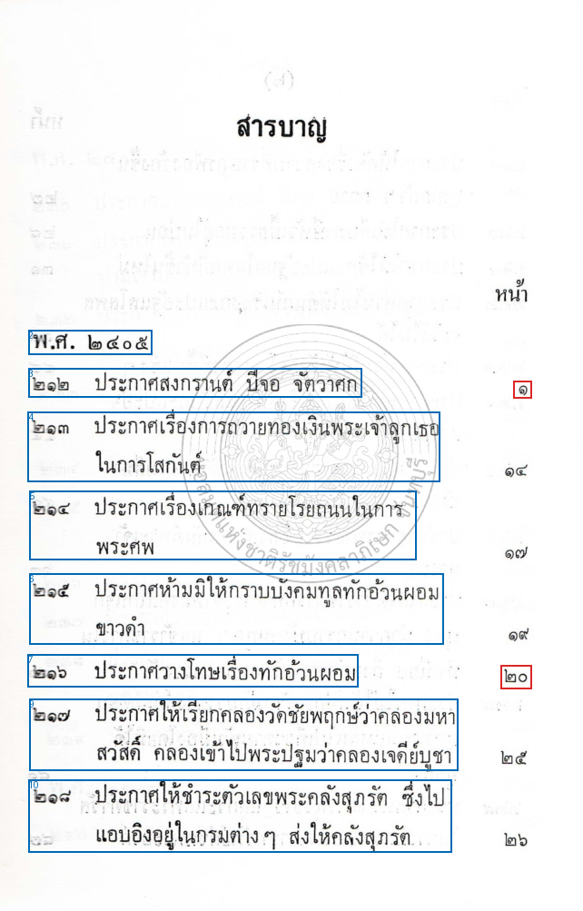
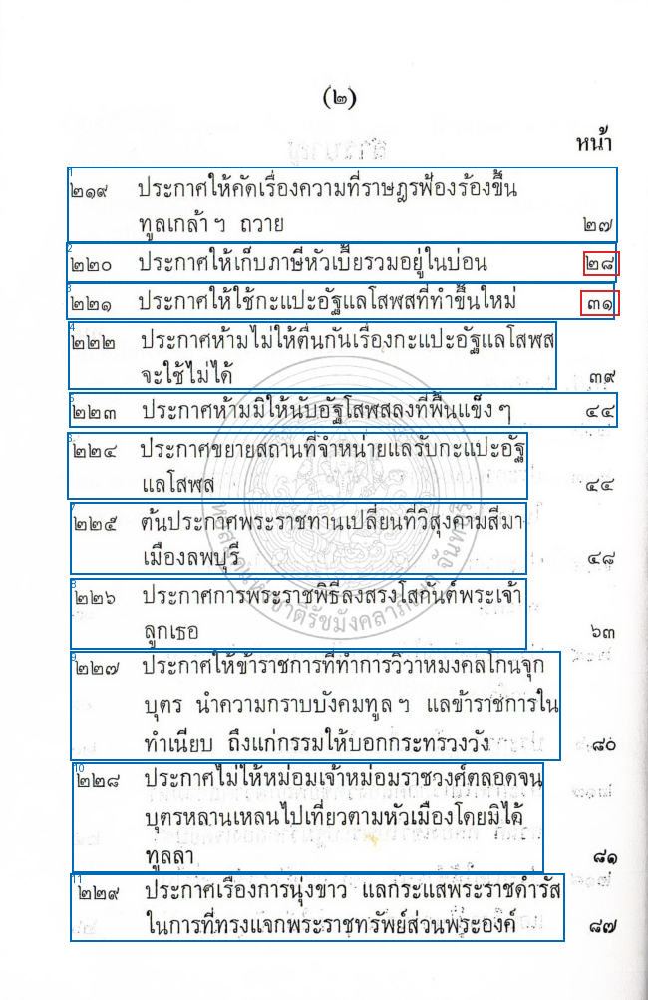
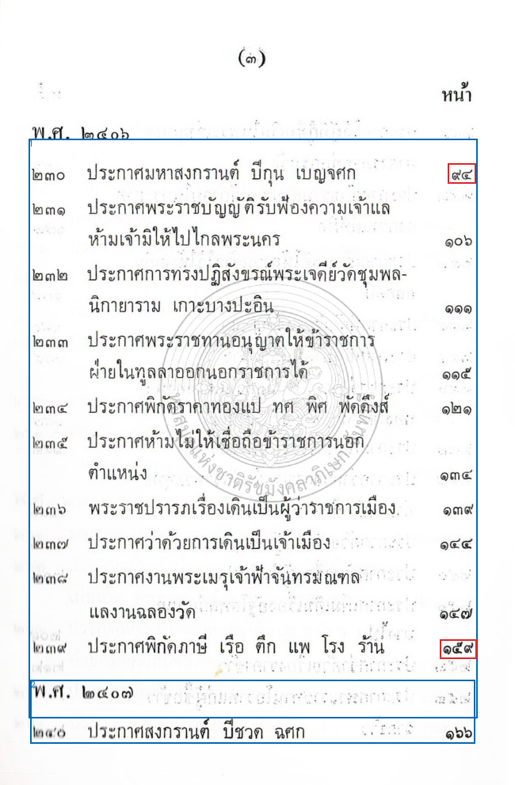
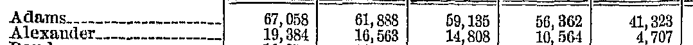
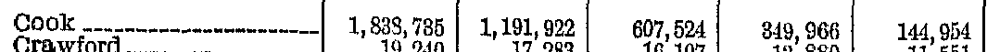
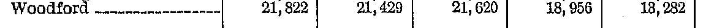
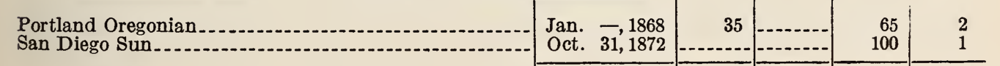

# แยกสาเหตุตารางผิด 11/15 แถว

**ควรแก้การเลือกบริเวณและแยกแถวก่อน แล้วทดสอบตัวอ่านตัวเลขแยกต่างหาก ยังไม่มีหลักฐานพอให้เปลี่ยนโมเดลทั้งระบบทันที** ความผิดไม่ได้มาจากสาเหตุเดียว และความผิดด้านโครงสร้างก็อาจเกิดจากตัวโมเดลที่สร้างตารางได้ ไม่ใช่โค้ด pipeline อย่างเดียว

ตรวจจากผล forced OCR หลังแก้รุ่น `9859627a68a7960f575a91f50aba34107543dbda` ใน [รอบ 3c](../ocr-accuracy-round3c-2026-11-02/REPORT.md) เทียบภาพ PDF จริงทั้ง 15 แถว, HTML ในผลสุดท้าย และ `regions/block_content/block_bbox` ใน page telemetry ไม่มีการรันโมเดลใหม่หรือเปลี่ยนเฉลย คะแนนเดิมยัง **4/15** ไม่มีการแก้ runtime หรือ main

## สรุปอาการหลัก

| อาการหลักที่ทำให้แถวตก | แถว | หลักฐาน | ขอบเขตการวินิจฉัย |
|---|---:|---|---|
| เลขหน้าไม่ถูกถอด/ไม่ผูกกับชื่อรายการ — ราชกิจจาฯ | 6 | เลขหน้าที่ต้องการไม่มีเป็นค่าของแถว; 2 ตำแหน่งอยู่นอกกรอบข้อความที่บันทึก อีก 4 อยู่ในกรอบแต่ไม่ถูกถอด | ทั้ง coverage/layout และ recognition/reading order; ยังไม่พิสูจน์ด้วย crop input จริงทุก request |
| อ่านค่าตัวเลขผิดในลำดับช่องเดิม — Census | 4 | 9 จาก 20 ช่องตัวเลขที่ตรวจใน 4 แถวผิด; ชื่อแถวและลำดับค่าที่เหลือสอดคล้องกับต้นฉบับ | Recognition error ชัด แต่ต้องแยกขนาดภาพ/บริบทออกก่อนตัดสินข้อจำกัดของโมเดล |
| รวมสองแถวเป็นแถวเดียว — Preservation | 1 | ค่า San Diego ครบ แต่อยู่ใน `<tr>` เดียวกับ Portland | Table structure error ตั้งแต่ผล region ก่อน API |
| ถูกตามเกณฑ์เดิม | 4 | Rock Island, Saline, New York Journal of Commerce, Brooklyn Daily Eagle | ตรวจยืนยัน ไม่ใช่ความผิดจากคะแนนอีก 11 แถว |

หมวดข้างบนจัดตามอาการหลักเพื่อไม่นับแถวซ้ำ ไม่ได้แปลว่า pipeline ผิด 7 แถวและโมเดลผิด 4 แถวอย่างตายตัว โดยเฉพาะราชกิจจาฯ มีชื่อรายการอ่านผิดร่วมด้วย 4/6 แถว

## ราชกิจจาฯ: ทั้งหกแถว

เอกสารเป็นสารบัญสามแนว: **เลขประกาศด้านซ้าย / ชื่อเรื่อง / เลขหน้าด้านขวา** ค่าอย่าง `๒๑๖` หรือ `๒๒๐` ในผล OCR เป็นเลขประกาศ ไม่ใช่เลขหน้า จึงเอามาแทนกันไม่ได้

| หน้าในชุดทดสอบ | รายการ | เลขหน้าต้นฉบับ | ผล OCR และอาการร่วม | กรอบตำแหน่งเลขหน้า |
|---|---|---|---|---|
| 1 | ประกาศสงกรานต์ ปีจอ จัตวาศก | ๑ | เลขหน้าหาย; `ปีจอ → ปี๒๐` | อยู่นอกกรอบข้อความทุกกรอบที่บันทึก |
| 1 | ประกาศวางโทษเรื่องทักอ้วนผอม | ๒๐ | ชื่อเรื่องถูก แต่เลขหน้าหาย | อยู่นอกกรอบข้อความทุกกรอบที่บันทึก |
| 2 | ประกาศให้เก็บภาษีหัวเบี้ยรวมอยู่ในบ่อน | ๒๘ | เลขหน้าหาย; `หัวเบี้ย → หัวเปีย`, `อยู่ใน → อยูโน` | อยู่ในกรอบ text #2 แต่ไม่ถูกถอด |
| 2 | ประกาศให้ใช้กะแปะอัฐแลโสฬศที่ทำขึ้นใหม่ | ๓๑ | เลขหน้าหาย; `ประกาศ → ปรากฏ`, `แลโสฬศ → และโสพส` | อยู่ในกรอบ text #3 แต่ไม่ถูกถอด |
| 3 | ประกาศมหาสงกรานต์ ปีกุน เบญจศก | ๙๔ | ชื่อเรื่องถูก แต่เลขหน้าหาย | อยู่ในกรอบ text #1 ขนาดใหญ่ แต่ไม่ถูกถอด |
| 3 | ประกาศพิกัดภาษี เรือ ตึก แพ โรง ร้าน | ๑๕๙ | เลขหน้าหาย; `แพ → แพง` | อยู่ในกรอบ text #1 ขนาดใหญ่ แต่ไม่ถูกถอด |

ตัวเลข `๒๐` ปรากฏในหน้า 1 จริง แต่เป็นการอ่านคำว่า `จอ` ผิดในชื่อรายการแรก จึงไม่ใช่หลักฐานว่าเลขหน้าของรายการวางโทษถูกอ่านแล้ว

ทั้งสามหน้าถูกจัดเป็น text regions ไม่ได้ส่งเข้า Table Recognition ดังนั้น **วิธีแบ่ง table bands ในรอบก่อนยังไม่เข้ามาช่วยสารบัญนี้** หน้า 1 กรอบด้านขวาขาด ส่วนหน้า 2–3 แม้เลขอยู่ภายในกรอบข้อความที่เก็บไว้ ก็ยังถูกละทิ้ง/จัดลำดับไม่ครบ ต้องทดสอบแยกการอ่านเลขด้านขวาและการผูกด้วยตำแหน่งแนวตั้ง ไม่ควรเพียงเพิ่มจำนวนโทเคน

กรอบสีน้ำเงินด้านล่างคือ `block_bbox` ของข้อความใน telemetry สีแดงคือตำแหน่งเลขหน้าที่ทำเครื่องหมายด้วยมือจากภาพต้นฉบับ หมายเลขกรอบเริ่มจาก 0 กรอบที่คืนมาไม่ใช่ log ของภาพ request ทุกใบ จึงเป็นหลักฐาน coverage ที่บันทึกไว้ ไม่ใช่ข้อพิสูจน์เด็ดขาดว่า pixel ใดถูกส่งให้ตัวอ่านจริง







## Census: สี่แถวที่ตก อ่านตัวเลขผิด

ตัวเลขด้านซ้ายของลูกศรเป็นค่าต้นฉบับ/เฉลยเดิม ด้านขวาเป็นผล OCR ไม่ใช่ค่าที่แก้คืน

| แถว / หน้า | ช่องที่ผิดทั้งหมดในห้าปีแรก | ช่องผิด / ช่องตรวจ | สิ่งที่ตรวจพบ |
|---|---|---:|---|
| Adams / 2 | 1880: `59,135 → 59,155`; 1870: `56,362 → 56,862` | 2/5 | ค่าอื่นยังเรียงตามปีเดิม |
| Alexander / 2 | 1900: `19,384 → 15,884`; 1890: `16,563 → 16,565`; 1880: `14,808 → 14,826`; 1870: `10,564 → 10,844` | 4/5 | ชื่อแถวถูก ไม่ใช่เอาแถวข้างเคียงมาแทนทั้งแถว |
| Cook / 2 | 1900: `1,838,735 → 1,833,785`; 1870: `349,966 → 849,966` | 2/5 | ปี 1890, 1880, 1860 ยังถูก |
| Woodford / 3 | 1860: `13,282 → 18,282` | 1/5 | สี่ค่าแรกถูก; ก่อนแก้แถวนี้เคยผ่าน |

ตัวเลขผิดเหล่านี้อยู่ใน `block_content` ของ table region แล้ว และค่าต่อเซลล์ตรงกับ final HTML ทุกกรณี จึงไม่มีหลักฐานว่า API ตัดข้อความหรือขั้นลด HTML ทำให้ตัวเลขเปลี่ยน







**มีปัญหาโครงสร้างรองด้วย:** Table 2 หน้า 2 สร้างหัว `COUNTIES` เป็น `colspan="2"` ทั้งที่ภาพมีคอลัมน์ชื่อหนึ่งคอลัมน์ และเพิ่มช่องว่างท้ายแถว ผลคือการขยาย HTML grid อาจจับปีเข้ากับช่องผิด แม้ลำดับตัวเลขใน body ที่ตรวจยังอ่านเทียบตรงได้ คะแนนเดิมตรวจเพียง label+ค่าที่ต่อเนื่อง ไม่ได้พิสูจน์การจับหัวคอลัมน์ จึงต้องเพิ่มการตรวจ schema แยกจากคะแนนเดิม

คะแนน Census ก่อน→หลัง `1/6 → 2/6` มาจาก **Rock Island และ Saline ดีขึ้นสองแถว แต่ Woodford เสียไปหนึ่งแถว** ไม่ใช่ทุกแถวเดิมดีขึ้นพร้อมกัน

## Preservation: San Diego Sun มีค่าครบ แต่รวมแถว

ต้นฉบับแยก Portland และ San Diego เป็นสองแถว:



ผล region และ final HTML คืนมาเหมือนกัน:

```html
<tr>
  <td>Portland Oregonian San Diego Sun</td>
  <td>Jan. —, 1868 Oct. 31, 1872</td>
  <td>35</td><td></td><td>65 100</td><td>2 1</td>
</tr>
```

`San Diego Sun`, `Oct. 31, 1872`, `100`, `1` ยังอยู่ครบ แต่แต่ละช่องปะปนค่าจาก Portland จึงล้มที่การแยกแถว ไม่ใช่อ่าน `1872` หรือ `100` ผิด และไม่ควรแก้คะแนนให้ผ่านเพียงเพราะค้นเจอคำเหล่านี้ในทั้งตาราง

## ควรแก้ pipeline หรือทดสอบโมเดลอื่น

1. **แก้การรักษาบริเวณและโครงสร้างก่อน:** สารบัญต้องตรวจเจอแนวเลขประกาศ/ชื่อ/เลขหน้าให้ครบ แล้วผูกด้วยพิกัดแถว รวมถึงรองรับชื่อที่กินหลายบรรทัด ตารางต้องตรวจจำนวนคอลัมน์และหัวตาราง ไม่ยอมรับ phantom colspan หรือสองแถวที่ถูกรวมโดยไม่มีหลักฐานจากภาพ การตรวจไม่ผ่านควรส่งอ่านใหม่เฉพาะบริเวณ ไม่แก้ค่าจากการเดา
2. **แยกทดสอบตัวอ่านด้วยภาพเดียวกัน:** สำหรับ 9 ช่องตัวเลขที่ผิดและเลขหน้าที่หล่น ให้โมเดลปัจจุบันอ่านภาพแถว/เซลล์ที่ครอบถูกแน่นอน เปรียบเทียบกับการอ่านทั้งตารางบน pixel เดียวกัน ห้ามส่งเฉลยเข้า prompt หาก crop อ่านถูกแต่ทั้งตารางผิด ให้เน้น segmentation/context; หาก crop ยังผิด จึงมีเหตุผลทดสอบ recognizer อีกตัวบน crop เดิม
3. **เลือกเปลี่ยนเฉพาะส่วนตามผล:** หากอีกโมเดลอ่าน crop เดิมดีกว่าจริง ค่อยเปลี่ยนตัวอ่านตัวเลขหรือเอกสารไทยเป็นบางเส้นทาง ไม่จำเป็นต้องเปลี่ยนทั้งระบบ ประเมิน strict rows, cell accuracy และ row/column association แยกกัน พร้อมเวลาและ RAM จากนั้นยืนยันบนเอกสารที่ไม่ได้ใช้ปรับระบบชุดนี้

นี่คือข้อเสนอการทดลองถัดไป ไม่ใช่ผลยืนยันว่าวิธีใหม่หรือโมเดลอื่นจะชนะ การตรวจครั้งนี้ใช้ผลบันทึกเดิม ไม่รัน inference ใหม่ ไม่ใช้ Firecrawl และไม่กระทบบริการ production

## ตรวจย้อนกลับ

- [ข้อมูลรายแถวทั้ง 15 แถว](audit.json) ระบุค่าคาดหวัง ผลที่พบ ประเภทความผิด กรอบที่ครอบเลขหน้า และ region ต้นทาง
- [สคริปต์ตรวจซ้ำ](audit.py) ยืนยัน reference hash เดิม, source PDF hashes, ผลคะแนน 4/15 และค่าของ HTML ก่อน/หลังขั้น API; ต้องมี PDF ใน `.cache/ocr-diagnosis/` และ dependencies เดิม
- Hash เฉลยแบบ canonical: `72a37213b39a3a3dd1b4e344162d962b39c3c460fcad2bf2dfea105620301ac2`
- ใช้ผู้ตรวจหนึ่งราย ภาพขยายมาจาก scan เดิม ไม่ได้เพิ่มรายละเอียดที่ไม่มีในต้นฉบับ การจัดหมวดเป็น diagnostic annotation ไม่ใช่การเปลี่ยนเกณฑ์ benchmark
